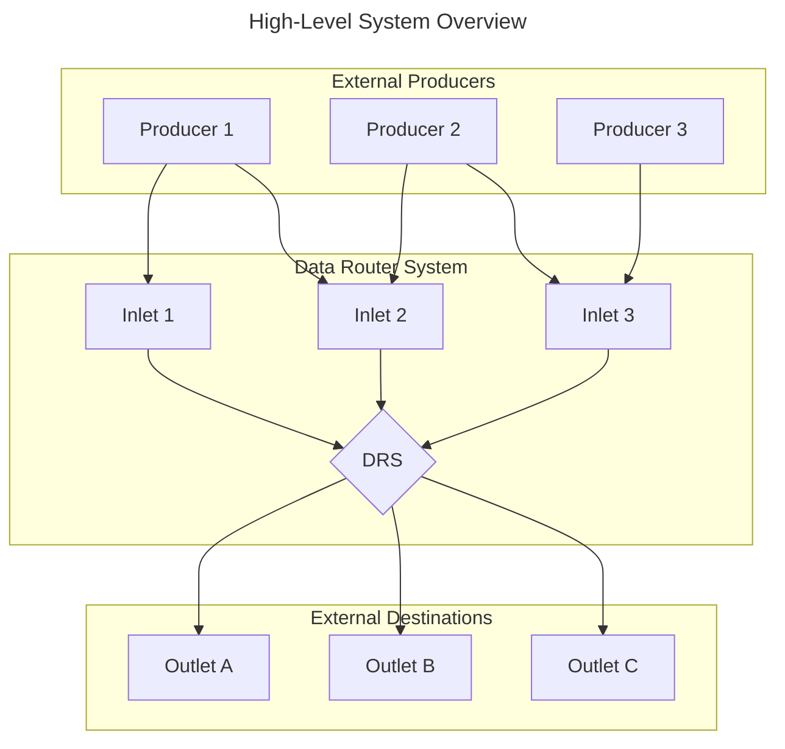
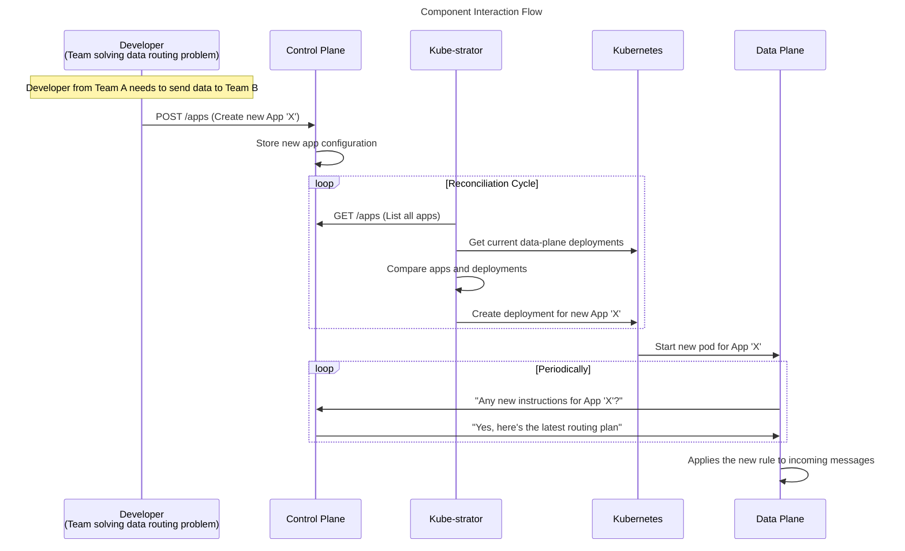
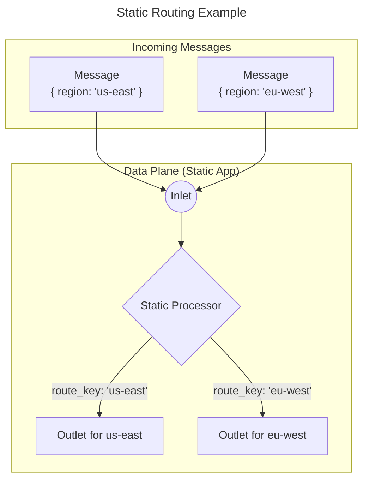
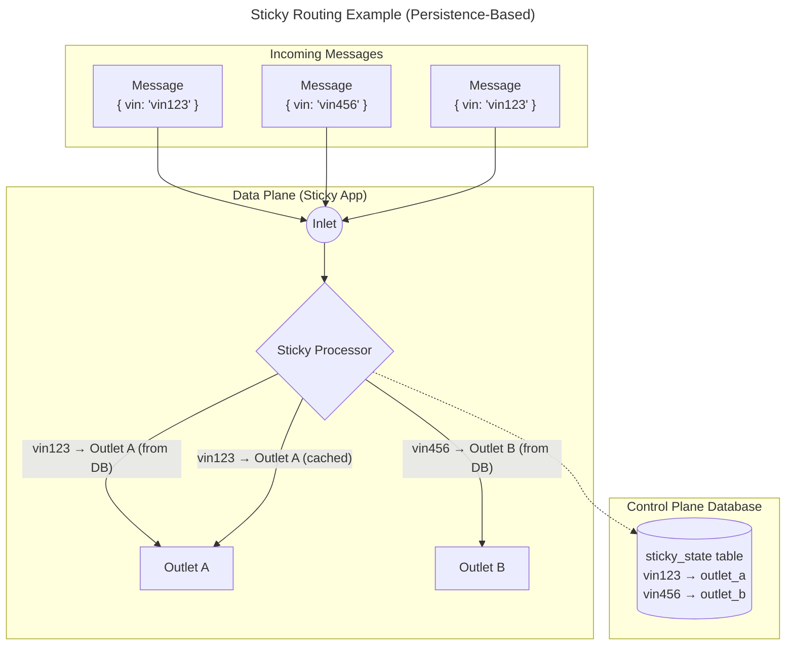

# Data Router System (DRS) - Architecture Overview

This document provides a comprehensive overview of the Data Router System's architecture, from a high-level conceptual view down to the component-level details.

## Part 1: High-Level Architecture (The "What" and "Why")

### 1. Introduction: What is the Data Router System?

- **Core Purpose:** The DRS is a scalable and reliable message routing platform designed to ingest data from various sources and route it to the correct destinations based on a flexible set of rules.
- **Key Analogy:** Think of it as a smart postal service for data. It receives messages, figures out the best route, and ensures they get to the right destination, even if there are delivery issues.

#### High-Level Diagram



### 2. The Four Core Components: Control Plane, Data Plane, DLQ & Kube-strator

The DRS is built on a fundamental separation of concerns, embodied by four primary services:

- **Control Plane (The "Brain"):**
    - **Function:** Manages all the routing rules and configurations. It provides a centralized API for defining *how* messages should be routed.
    - **Analogy:** The "dispatch manager" who has all the maps and delivery instructions.

- **Data Plane (The "Workhorse"):**
    - **Function:** Executes the routing. It takes the instructions from the Control Plane and performs the actual work of consuming, processing, and forwarding messages.
    - **Analogy:** The "delivery driver" who is on the road, following the instructions to deliver packages.

- **Dead Letter Queue (DLQ) (The "Safety Net"):**
    - **Function:** Handles messages that fail to be delivered after multiple attempts. It ensures reliable message delivery by storing failed messages and retrying them periodically.
    - **Analogy:** The "lost package recovery center" that holds undelivered packages and keeps trying to deliver them.

- **Kube-strator (The "Orchestrator") - Optional:**
    - **Function:** Manages the lifecycle of Data Plane deployments within a Kubernetes environment. It ensures that every application defined in the Control Plane has a corresponding Data Plane instance running. This component is optional but makes the maintenance of the Data Router seamless and automated.
    - **Analogy:** The "fleet manager" who ensures there are enough delivery drivers and that they are assigned to the correct routes.

#### Interaction Diagram

This diagram illustrates the clear separation of configuration, orchestration, and execution:



---

## Part 2: Component-Level Deep Dive (The "How")

### 1. The Control Plane in Detail

The Control Plane is the authoritative source for all routing configurations.

- **Core Entities:**
    - **App:** The top-level container for a routing configuration. It defines the overall routing strategy.
    - **Inlet:** The entry point for messages into the system for a given App. By design, an App has exactly **one** Inlet, as the Data Router System is intended to own and manage the single point of data ingress for a given application.
    - **Outlet:** The exit point for messages. An App can have **many** Outlets, allowing for flexible fan-out and routing strategies.
    - **Connector:** The actual connection to an external messaging system (e.g., Azure Event Hub). Connectors are used by both Inlets and Outlets to define the technical connection details.

- **Entity Relationship Diagram:**
    ```mermaid
    ---
    title: Control Plane Entity Relationships
    ---
    graph TD
        A[App] -- "1" --> B((Inlet));
        A -- "N" --> C((Outlets));
        B --> E[Connector];
        C --> E;
    ```

- **Key Functionality:**
    - Provides a REST API for CRUD (Create, Read, Update, Delete) operations on all configuration entities.
    - Validates all incoming configurations to ensure data integrity and prevent routing errors.
    - Stores all configurations in a central PostgreSQL database.

- **Scalability:**
    - The Control Plane scales horizontally by increasing replica count as it is a stateless API server.
    - All state is persisted in the PostgreSQL database, allowing multiple instances to serve requests concurrently.
    - Load balancing can be implemented at the service level to distribute API requests across replicas.

### 2. The Data Plane in Detail

The Data Plane is the high-throughput engine that performs the message routing.

- **Core Function:** To be a fast, efficient, and resilient message routing engine.
- **Key Components:**
    - **Message Router:** The central component that orchestrates the routing process.
    - **Processors:** Specialized, pluggable modules for each routing strategy (`StaticProcessor`, `StickyProcessor`).
    - **Control Plane Client:** A dedicated client that polls the Control Plane for the latest routing rules.

- **Message Flow Diagram:**
    ```mermaid
    ---
    title: Data Plane Message Flow
    ---
    sequenceDiagram
        participant Inlet
        participant Data Plane
        participant Control Plane
        participant Outlet

        Inlet->>Data Plane: New message arrives
        Data Plane->>Control Plane: Fetch routing configuration
        Data Plane->>Data Plane: Apply routing logic (via Static or Sticky Processor)
        Data Plane->>Outlet: Send message to destination
    ```

- **Scalability:**
    - Each Data Plane instance is dedicated to a specific app and can scale horizontally by increasing replica count.
    - The maximum number of replicas is limited by the number of partitions in the inlet connector (e.g., Event Hub partitions).
    - Each replica processes messages from specific partitions, ensuring ordered processing within partitions.
    - Scaling is app-specific, allowing high-throughput apps to have more replicas while low-volume apps use fewer resources.

### 3. The Kube-strator in Detail

The Kube-strator service is the bridge between the abstract application definitions in the Control Plane and the concrete, running deployments in Kubernetes.

- **Core Function:** To automate the deployment and management of Data Plane instances.
- **Key Components:**
    - **Reconciler:** The core loop that periodically compares the desired state (from the Control Plane) with the actual state (in Kubernetes) and takes action to converge them.
    - **Control Plane Client:** A dedicated HTTP client for fetching the list of all registered applications from the Control Plane's API.
    - **Kubernetes Client:** A client for interacting with the Kubernetes API to manage `Deployment` resources.

- **Reconciliation Flow Diagram:**
    ```mermaid
    ---
    title: Kube-strator Reconciliation Flow
    ---
    graph TD
        subgraph Kube-strator
            A[Start Reconciliation] --> B{Fetch All Apps from Control Plane};
            B --> C{Fetch All Data Plane Deployments from K8s};
            C --> D{Diff: Apps vs. Deployments};
            D --> E{Identify Apps to Create};
            D --> F{Identify Deployments to Delete};
            E --> G[Create K8s Deployment];
            F --> H[Delete K8s Deployment];
        end
        subgraph External Systems
            CP[Control Plane API]
            K8s[Kubernetes API]
        end
        B --> CP;
        C --> K8s;
        G --> K8s;
        H --> K8s;
    ```

### 4. Routing Strategies: STATIC vs. STICKY

The DRS supports two primary routing strategies to cover a variety of use cases.

| Strategy | Description | Use Case | Example |
|---|---|---|---|
| **STATIC** | Simple, key-based routing. If a message has a specific key, it goes to a predefined outlet. | Partitioning data based on a known attribute (e.g., region, customer type). | `{"static_mapping": {"key1": "outlet1"}}` |
| **STICKY** | Affinity-based routing. Messages with the same "sticky" parameter (e.g., a `vehicle_id`) will always go to the same outlet. | Processing all messages for a specific entity in the same place (e.g., for stateful analysis or sessionization). | `{"routing_param": "vin", "sticky_mapping": {"vin123": "outlet1"}}` |

#### Static Routing Flow

In a static routing setup, the Data Plane routes incoming messages based on a direct mapping of a key in the message to a specific outlet.



#### Sticky Routing Flow

In a sticky routing setup, the Data Plane ensures that messages with the same value for a "sticky" parameter (e.g., `vin`) are consistently sent to the same outlet. This is achieved through **persistent mapping** stored in the database, not through hashing. When a new sticky key is encountered, the system assigns it to the outlet with the least number of current assignments to ensure load balancing.

**How Sticky Routing Works:**
1. **First Message with New Key:** When a message arrives with a new sticky key (e.g., `vin123`), the system checks the database for existing mapping
2. **Load Balancing Assignment:** If no mapping exists, the system assigns the key to the outlet with the least number of current assignments
3. **Persistent Storage:** The mapping is stored in the `control_plane.sticky_state` table
4. **Consistent Routing:** All subsequent messages with the same key are routed to the same outlet based on the persistent mapping
5. **Caching:** The Data Plane caches mappings locally for performance



### 5. Ensuring Reliability: The Dead Letter Queue (DLQ)

The DLQ is a critical feature within the Data Plane for guaranteeing data delivery. It is not a separate service but rather a dedicated process that runs as part of the Data Plane deployment.

- **Purpose:** To safely capture and store messages that fail to be delivered to their intended outlet after multiple attempts.
- **How it Works:**
    1. If a Data Plane worker fails to deliver a message to an outlet (due to a transient error, for example), it moves the message to a dedicated DLQ table in the database.
    2. A separate DLQ processor, running within the Data Plane container, periodically scans this table and retries sending the messages.
    3. This mechanism prevents data loss and ensures that temporary downstream issues do not cause permanent failures.

- **Error Flow Diagram:**
    ```mermaid
    ---
    title: DLQ Error and Retry Flow
    ---
    sequenceDiagram
        participant Data Plane Worker
        participant Outlet
        participant Data Plane DLQ Processor
        participant Database

        Data Plane Worker->>Outlet: Attempt to deliver message
        Outlet-->>Data Plane Worker: Delivery fails
        Data Plane Worker->>Database: Store message in DLQ table

        loop Periodic Retry Cycle
            Data Plane DLQ Processor->>Database: Fetch batch of DLQ messages
            Data Plane DLQ Processor->>Outlet: Retry delivering message
            alt Delivery Succeeds
                Data Plane DLQ Processor->>Database: Delete message from DLQ table
            else Delivery Fails Again
                Data Plane DLQ Processor->>Database: Update retry count/timestamp
            end
        end
    ```

- **Scalability:**
    - The DLQ processor currently runs as a single instance per Data Plane deployment and is not built for horizontal scaling.
    - It processes failed messages sequentially to maintain order and prevent duplicate processing.
    - For high-volume scenarios, the DLQ can be optimized through batch processing and configurable retry intervals.
    - The design prioritizes reliability over throughput, ensuring no message loss during failure recovery.

- **Scalability:**
    - The Kube-strator currently runs as a single instance and is designed for single-node operation.
    - It does not require immediate horizontal scaling as the reconciliation workload is typically lightweight.
    - The service can handle hundreds of applications with minimal resource usage.
    - Future enhancements could include leader election patterns for high availability if needed.

---

## Part 3: Summary

### Architectural Principles & Benefits

- **Separation of Concerns:** The clear split between the Control Plane (configuration) and Data Plane (execution) allows for independent scaling and development.
- **Flexibility:** The API-driven model and multiple routing strategies allow the DRS to adapt to new use cases without architectural changes.
- **Reliability:** The DLQ and robust error handling ensure high-availability and prevent data loss.
- **Scalability:** The Data Plane is designed to be a stateless service that can be scaled horizontally to handle massive message volumes.
- **Maintainability:** The modular design (e.g., Processors) makes the system easier to understand, test, and extend.
