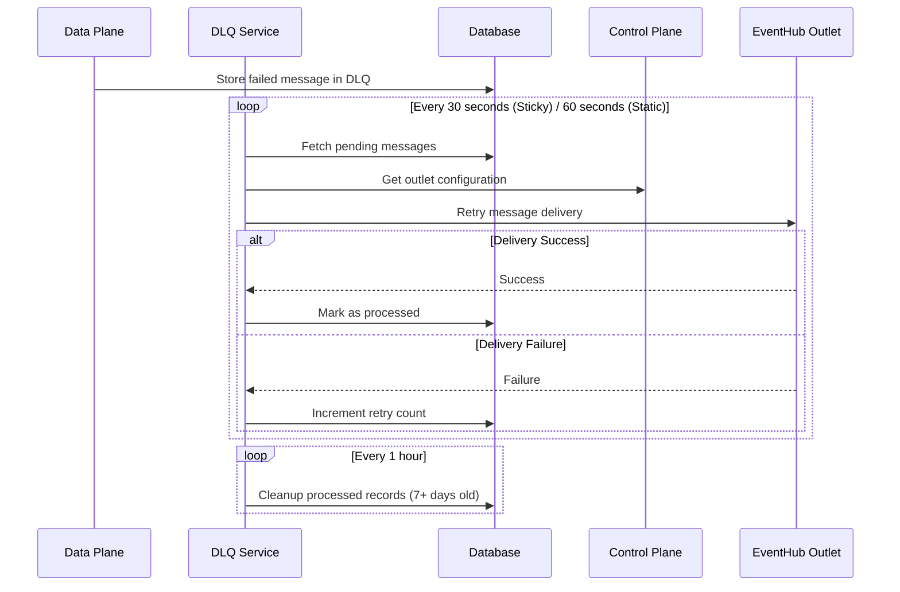

# Dead Letter Queue (DLQ) Service

## Overview

The Dead Letter Queue (DLQ) service is a critical component of the Data Plane that ensures reliable message delivery by handling failed message retries and recovery operations. It runs as part of the Data Plane deployment and processes messages that couldn't be delivered to their intended outlets on the first attempt.

## Architecture

### Core Components

1. **DLQ Service**: Main orchestrator that manages processing cycles and timing
2. **DLQ Processor**: Handles message retry logic and outlet communication
3. **DLQ Data Access**: Database operations for DLQ table management
4. **Control Plane Client**: Fetches outlet configurations and static mappings
5. **EventHub Producers**: Manages connections to outlet EventHubs

### Processing Architecture



## Processing Modes

### Sticky Message Processing
- **Frequency**: Every 30 seconds (configurable via `DLQ_STICKY_INTERVAL_IN_SECS`)
- **Target**: Messages with known outlet IDs from sticky routing
- **Batch Processing**: Up to 100 messages per outlet per cycle
- **Retry Strategy**: Immediate retry on failure with exponential backoff

### Static Message Processing  
- **Frequency**: Every 60 seconds (configurable via `DLQ_STATIC_INTERVAL_IN_SECS`)
- **Target**: Messages pending outlet assignment from static routing
- **Mapping Resolution**: Fetches static mappings from Control Plane
- **Batch Processing**: Groups by app name for efficient mapping resolution

### Cleanup Processing
- **Frequency**: Every 1 hour (configurable via `DLQ_CLEANUP_INTERVAL_IN_SECS`)
- **Target**: Successfully processed messages older than 7 days
- **Storage Management**: Prevents DLQ table growth and maintains performance
- **Batch Deletion**: Removes records in controlled batches

## Message Lifecycle

### 1. Message Failure
```sql
INSERT INTO data_plane.dlq (
    app_name, outlet_id, static_key, data, 
    error_message, retry_count, created_at
) VALUES (...);
```

### 2. Retry Processing
- DLQ service fetches pending messages based on outlet_id
- Creates/reuses EventHub producer for the outlet
- Attempts batch message delivery
- Updates retry count on failure or marks as processed on success

### 3. Cleanup
```sql
DELETE FROM data_plane.dlq 
WHERE processed_at IS NOT NULL 
AND processed_at < NOW() - INTERVAL '7 days';
```

## Configuration

### Environment Variables

#### Required
```env
# Control Plane Configuration
CONTROL_PLANE_BASE_URL=http://localhost:4001

# Database Configuration  
PGHOST=localhost
PGPORT=5432
PGUSER=postgres
PGPASSWORD=postgrespassword
PGDATABASE=postgres
```

#### DLQ-Specific Configuration
```env
# Processing Intervals (seconds)
DLQ_STICKY_INTERVAL_IN_SECS=30    # Sticky message processing
DLQ_STATIC_INTERVAL_IN_SECS=60    # Static message processing
DLQ_CLEANUP_INTERVAL_IN_SECS=3600 # Cleanup old records (1 hour)

# Retry Configuration
DLQ_RETRY_STRATEGY=exponential    # Retry strategy: 'exponential' (default) or 'fixed'
DLQ_RETRY_DELAY_SECS=300          # Base delay in seconds (5 minutes default)
DLQ_MAX_RETRY_DELAY_SECS=3600     # Max delay cap for exponential backoff (1 hour default)
DLQ_MAX_RETRIES=5                 # Maximum retry attempts before giving up

# Performance Configuration
DLQ_BATCH_SIZE=100                # Messages per processing batch
DLQ_RETENTION_DAYS=7              # Days to retain processed messages
```

## Database Schema

### DLQ Table Structure
```sql
CREATE TABLE data_plane.dlq (
    id UUID PRIMARY KEY DEFAULT gen_random_uuid(),
    app_name TEXT NOT NULL,
    outlet_id UUID,                -- NULL for static messages awaiting mapping
    static_key TEXT,               -- NULL for sticky messages
    data JSONB NOT NULL,           -- Original message data
    error_message TEXT,            -- Last error encountered
    retry_count INTEGER DEFAULT 0, -- Number of retry attempts
    created_at TIMESTAMPTZ DEFAULT NOW(),
    processed_at TIMESTAMPTZ,      -- NULL until successfully processed
    last_retry_at TIMESTAMPTZ      -- Last retry attempt timestamp
);

-- Indexes for efficient querying
CREATE INDEX idx_dlq_outlet_id ON data_plane.dlq(outlet_id) WHERE processed_at IS NULL;
CREATE INDEX idx_dlq_static_key ON data_plane.dlq(app_name, static_key) WHERE outlet_id IS NULL;
CREATE INDEX idx_dlq_cleanup ON data_plane.dlq(processed_at) WHERE processed_at IS NOT NULL;
```

## Retry Strategy

### Retry Logic
1. **Initial Failure**: Message stored in DLQ with retry_count = 0
2. **Retry Attempts**: Incremented on each failure (max configurable via `DLQ_MAX_RETRIES`, default 5)
3. **Retry Strategy**: Configurable via `DLQ_RETRY_STRATEGY` — see strategies below
4. **Max Retries**: Messages exceeding the limit remain in DLQ for manual intervention

### Reprocessing Strategies

Two retry timing strategies are supported, selected via the `DLQ_RETRY_STRATEGY` environment variable:

#### Exponential Backoff (default: `DLQ_RETRY_STRATEGY=exponential`)
Delay grows exponentially with each retry attempt, capped at `DLQ_MAX_RETRY_DELAY_SECS`:

```
delay = min(DLQ_RETRY_DELAY_SECS * 2^retry_count, DLQ_MAX_RETRY_DELAY_SECS)
```

With defaults (`DLQ_RETRY_DELAY_SECS=300`, `DLQ_MAX_RETRY_DELAY_SECS=3600`):

| Attempt | retry_count | Wait before retry |
|---------|-------------|-------------------|
| 1st     | 0           | 5 min (300s)      |
| 2nd     | 1           | 10 min (600s)     |
| 3rd     | 2           | 20 min (1200s)    |
| 4th     | 3           | 40 min (2400s)    |
| 5th     | 4           | 60 min (3600s, capped) |

This is the recommended strategy for production — it naturally backs off pressure on a struggling downstream system.

#### Fixed Delay (`DLQ_RETRY_STRATEGY=fixed`)
A constant delay between every retry attempt:

```
delay = DLQ_RETRY_DELAY_SECS (constant)
```

Useful for predictable retry behaviour or when exponential backoff is not appropriate.

### Error Handling
- **Transient Failures**: Network issues, temporary EventHub unavailability
- **Configuration Errors**: Missing outlet configuration, invalid credentials
- **Message Validation**: Malformed message data or routing parameters
- **Circuit Breaking**: Prevents cascade failures during outlet outages

## Monitoring and Metrics

### Key Metrics

#### Processing Metrics
- `dlq_sticky_processing`: Time to process sticky messages
- `dlq_static_processing`: Time to process static messages  
- `dlq_messages_processed`: Successfully retried messages
- `dlq_messages_failed`: Failed retry attempts
- `dlq_batch_size`: Number of messages per processing batch

#### Health Metrics
- `dlq_service_uptime_seconds`: Service availability
- `dlq_sticky_outlets_pending`: Outlets with pending sticky messages
- `dlq_static_keys_pending`: Static keys awaiting mapping
- `dlq_cleanup_eligible`: Records eligible for cleanup

#### Performance Metrics
- `dlq_processing_duration_ms`: Overall processing cycle time
- `dlq_outlet_processing_duration_ms`: Per-outlet processing time
- `dlq_producer_created`: New EventHub connections created
- `dlq_cleanup_total`: Records cleaned up per cycle

### Operational Monitoring

#### Dashboard Metrics
- Current DLQ depth (total pending messages)
- Processing throughput (messages/second)
- Error rates by outlet/app
- Retry success rates
- Average processing latency

#### Alerts
- DLQ depth exceeding threshold (e.g., >1000 messages)
- High error rates (>10% failures)
- Processing delays (cycles taking >5 minutes)
- Cleanup failures
- EventHub connection failures

## Deployment

### Standalone DLQ Service
```bash
# Start DLQ service separately
node dist/dlq.js
```

### Integrated with Data Plane
The DLQ service typically runs as part of the Data Plane deployment:
```yaml
apiVersion: apps/v1
kind: Deployment
metadata:
  name: data-plane-dlq
spec:
  replicas: 1  # Single instance per app
  template:
    spec:
      containers:
      - name: dlq-processor
        image: data-plane:latest
        command: ["node", "dist/dlq.js"]
        env:
        - name: DLQ_STICKY_INTERVAL_IN_SECS
          value: "30"
        - name: DLQ_STATIC_INTERVAL_IN_SECS  
          value: "60"
```

## Scalability Considerations

### Current Design
- **Single Instance**: One DLQ processor per Data Plane deployment
- **Sequential Processing**: Messages processed in order within each outlet
- **Batch Processing**: Multiple messages processed together for efficiency
- **Connection Reuse**: EventHub producers cached and reused

### Performance Optimization
- **Batch Size Tuning**: Adjust based on message volume and processing time
- **Interval Tuning**: Balance between responsiveness and resource usage
- **Connection Pooling**: Reuse EventHub connections across processing cycles
- **Database Indexing**: Optimize queries for large DLQ tables

### Future Enhancements
- **Horizontal Scaling**: Multiple DLQ processors with coordination
- **Prioritization**: Critical message processing priority
- **Jitter**: Add random jitter to exponential backoff to prevent thundering herd
- **Dead Letter Storage**: Long-term storage for permanently failed messages (exceeded max retries)

## Troubleshooting

### Common Issues

1. **Messages Not Being Retried**
   - Check DLQ service logs for processing errors
   - Verify Control Plane connectivity
   - Ensure outlet configurations are valid
   - Check EventHub credentials and permissions

2. **High Retry Failure Rates**
   - Review outlet EventHub status and connectivity
   - Check EventHub throughput limits and throttling
   - Verify message format and content validity
   - Monitor downstream system health

3. **DLQ Table Growth**
   - Verify cleanup process is running
   - Check cleanup configuration and intervals
   - Monitor database disk space and performance
   - Review retention policy and cleanup thresholds

4. **Processing Delays**
   - Monitor processing cycle times and batch sizes
   - Check database query performance and indexing
   - Review EventHub connection and producer performance
   - Consider adjusting processing intervals

### Debug Commands

```bash
# Check DLQ table contents
SELECT app_name, COUNT(*) as pending_count 
FROM data_plane.dlq 
WHERE processed_at IS NULL 
GROUP BY app_name;

# View recent failures
SELECT * FROM data_plane.dlq 
WHERE retry_count > 0 
ORDER BY last_retry_at DESC 
LIMIT 10;

# Check processing statistics
SELECT 
  DATE_TRUNC('hour', created_at) as hour,
  COUNT(*) as total_messages,
  COUNT(processed_at) as processed_messages,
  AVG(retry_count) as avg_retries
FROM data_plane.dlq 
WHERE created_at > NOW() - INTERVAL '24 hours'
GROUP BY hour 
ORDER BY hour;

# Monitor service logs
docker logs <data-plane-container> | grep -i dlq
```

### Performance Tuning

```bash
# Analyze processing bottlenecks
SELECT 
  outlet_id,
  COUNT(*) as message_count,
  AVG(retry_count) as avg_retries,
  MAX(created_at) as latest_message
FROM data_plane.dlq 
WHERE processed_at IS NULL 
GROUP BY outlet_id 
ORDER BY message_count DESC;

# Check cleanup efficiency
SELECT 
  COUNT(*) as eligible_for_cleanup
FROM data_plane.dlq 
WHERE processed_at IS NOT NULL 
AND processed_at < NOW() - INTERVAL '7 days';
```

## Integration

The DLQ service integrates with:
- **Data Plane**: Receives failed messages for retry processing
- **Control Plane**: Fetches outlet configurations and static mappings
- **PostgreSQL**: Stores and manages DLQ message state
- **EventHub Outlets**: Retries message delivery to external systems
- **Monitoring Systems**: Exports metrics and health status