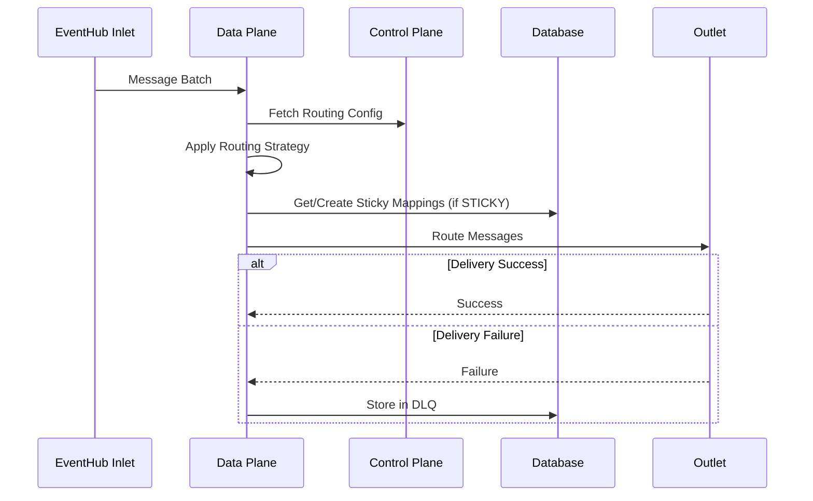

# Data Plane Service

## Overview

The Data Plane is the high-throughput message routing engine of the Data Router System (DRS). It consumes messages from EventHub inlets, applies routing strategies configured in the Control Plane, and delivers messages to appropriate outlets. The service includes robust error handling with Dead Letter Queue (DLQ) support for guaranteed message delivery.

## Key Responsibilities

- **Message Processing**: Consume messages from EventHub inlets
- **Routing Execution**: Apply STATIC or STICKY routing strategies
- **Message Delivery**: Route messages to appropriate EventHub outlets
- **Error Handling**: Move failed messages to DLQ for retry processing
- **Configuration Sync**: Fetch latest routing rules from Control Plane
- **Performance Monitoring**: Track throughput, latency, and error metrics

## Architecture

### Core Components

1. **Data Plane Service**: Main orchestrator that manages message flow
2. **Message Processors**: 
   - **Static Processor**: Routes based on exact key matching
   - **Sticky Processor**: Routes with affinity using persistent database mappings
   - **DLQ Processor**: Handles failed message retries
3. **Control Plane Client**: Fetches routing configuration
4. **App Instance Service**: Manages application state and lifecycle

### Message Flow



## Routing Strategies

### Static Routing
- Routes messages based on exact key matching
- Static mappings defined in Control Plane: `routingKey → outletId`
- Deterministic and predictable routing
- Example: Route by tenant ID, region, or environment

### Sticky Routing  
- Routes messages with same key to same outlet consistently
- Uses persistent database mappings (not hashing)
- New keys assigned to outlet with least current assignments
- Provides load balancing while maintaining affinity
- Example: Route vehicle data by VIN to ensure all data for a vehicle goes to same analytics stack

## Dead Letter Queue (DLQ)

### Features
- Automatic retry of failed messages
- Configurable retry intervals and maximum attempts
- Message persistence with metadata
- Error tracking and reporting
- Manual recovery capabilities

### Process
1. Message delivery fails to outlet
2. Message moved to DLQ table with error details
3. DLQ processor periodically retries failed messages
4. Successful deliveries remove messages from DLQ
5. Messages exceeding retry limit remain in DLQ for manual intervention

## Configuration

### Environment Variables

#### Required
```env
# Application Configuration
DATA_PLANE_APPS_TO_ROUTE=sticky-app,static-app

# Control Plane
CONTROL_PLANE_BASE_URL=http://localhost:4001

# Database
PGHOST=localhost
PGPORT=5432
PGUSER=postgres
PGPASSWORD=postgrespassword
PGDATABASE=postgres
PGSSLMODE=false

# Azure Storage (for EventHub checkpointing)
STORAGE_ACCOUNT_CONNECTION_STRING=DefaultEndpointsProtocol=http;AccountName=account1;...
```

#### Authentication
```env
# Azure AD Authentication (only required if Control Plane has ENABLE_AUTH=true)
AZURE_DATA_PLANE_CLIENT_ID=your-service-client-id
AZURE_DATA_PLANE_CLIENT_SECRET=your-service-client-secret
AZURE_DATA_PLANE_TENANT_ID=your-tenant-id

# Optional: Custom authentication scope (defaults to Control Plane client ID)
AZURE_SERVICE_SCOPE=api://your-control-plane-client-id/.default
```

#### Optional
```env
# Performance Tuning
EVENTHUB_MAX_BATCH_SIZE=2000
EVENTHUB_MAX_WAIT_TIME=10000
EVENTHUB_PREFETCH_COUNT=6000
DLQ_PROCESSING_INTERVAL=5000
DLQ_BATCH_SIZE=500

# Connection Pooling
MIN_PG_CONNECTIONS=2
MAX_PG_CONNECTIONS=10
PG_POOL_IDLE_TIMEOUT=30000
PG_POOL_ACQUIRE_TIMEOUT=60000

# DLQ Configuration
DLQ_STATIC_INTERVAL_IN_SECS=60
DLQ_STICKY_INTERVAL_IN_SECS=30
DLQ_CLEANUP_INTERVAL_IN_SECS=3600
DLQ_RETRY_DELAY_SECS=300
```

## Quick Start

### Prerequisites
- Node.js 22.14.0
- PostgreSQL database with DRS schema
- Control Plane service running
- EventHub emulator or Azure EventHub

### Development
```bash
# Install dependencies
npm install

# Build the service
npm run build

# Start with specific apps
npm start sticky-app static-app

# Or use environment variable
DATA_PLANE_APPS_TO_ROUTE=sticky-app,static-app npm start
```

### Testing
```bash
# Run unit tests
npm test

# Run integration tests  
npm run test:integration

# Setup test data
npm run setup:test-data
```

## Deployment

### Single App Deployment
Each Data Plane instance handles one or more apps specified at startup:
```bash
# Single app
node dist/dataPlane.js sticky-app

# Multiple apps
node dist/dataPlane.js sticky-app static-app copy-job-app
```

### Kubernetes Deployment
- Managed automatically by Kube-strator service
- One deployment per app for isolation
- Resource limits: CPU and memory constraints
- Auto-scaling based on message volume

## Scalability

### Horizontal Scaling
- Each app can have multiple Data Plane replicas
- Maximum replicas limited by EventHub partition count
- Each replica processes specific partitions for ordered delivery
- Scaling managed by Kubernetes HPA or manual configuration

### Performance Considerations
- Batch processing for improved throughput
- Connection pooling for database efficiency
- Asynchronous message processing
- Configurable batch sizes and intervals

## Monitoring

### Key Metrics
- **Throughput**: Messages processed per second
- **Latency**: End-to-end processing time
- **Error Rate**: Failed delivery percentage  
- **DLQ Depth**: Number of messages in retry queue
- **Resource Usage**: CPU, memory, network utilization

### Health Checks
- Database connectivity
- Control Plane availability
- EventHub connection status
- Processing pipeline health

## Troubleshooting

### Common Issues

1. **Messages Not Processing**
   - Check EventHub connectivity and credentials
   - Verify Control Plane is accessible
   - Ensure app exists in Control Plane
   - Check routing parameter exists in messages

2. **High DLQ Volume**
   - Verify outlet EventHub connectivity
   - Check outlet credentials and permissions
   - Review error patterns in DLQ table
   - Monitor downstream system health

3. **Performance Issues**
   - Increase batch size for higher throughput
   - Add more replicas (up to partition limit)
   - Optimize database connection pooling
   - Check EventHub throttling limits

4. **Routing Errors**
   - Verify routing configuration in Control Plane
   - Check static key mappings
   - Ensure sticky routing has proper outlets configured
   - Validate message format and required fields

### Debug Commands
```bash
# Check app configuration
curl http://localhost:4001/app/{appName}

# View DLQ contents
SELECT * FROM data_plane.dlq WHERE app_name = 'your-app';

# Monitor processing logs
docker logs <data-plane-container> -f
```

## Authentication

The Data Plane automatically handles authentication to the Control Plane when Azure AD is enabled:

1. **Automatic Token Management**: Uses Azure AD client credentials flow for service-to-service authentication
2. **Fallback Strategy**: First tries Control Plane's `/auth/service-token` endpoint, then falls back to direct Azure AD
3. **Token Caching**: Caches access tokens and refreshes automatically before expiry
4. **Error Handling**: Gracefully handles authentication failures and retries

See the Control Plane's [AUTH.md](../control-plane/AUTH.md) for Azure AD setup instructions.

## Integration

The Data Plane integrates with:
- **Control Plane**: Fetches routing configuration and outlet details (with automatic authentication)
- **EventHub**: Consumes from inlets and produces to outlets  
- **PostgreSQL**: Stores sticky mappings and DLQ data
- **Kube-strator**: Managed deployment lifecycle
- **Monitoring Systems**: Exports metrics and health status